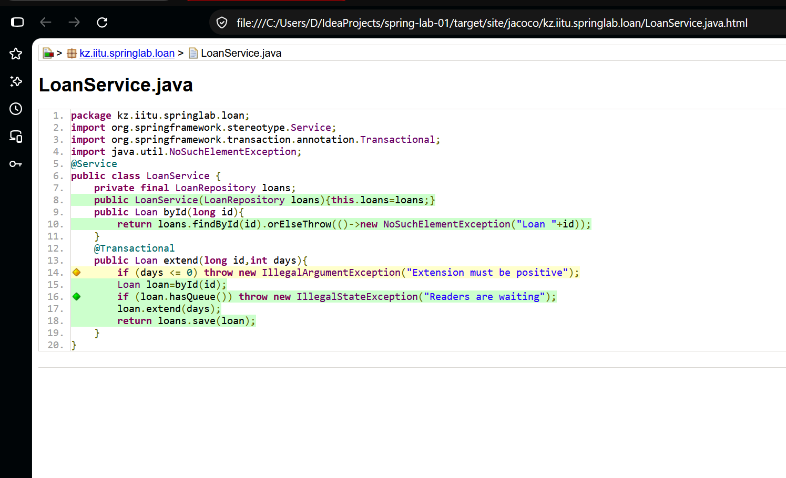
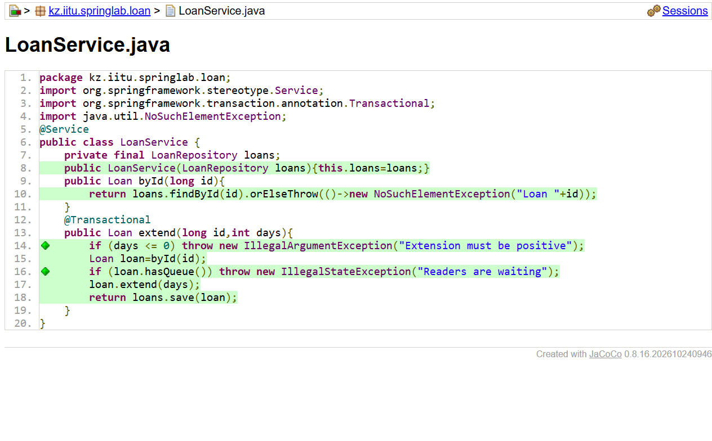

# Лабораторная работа №9 — автоматическое тестирование каталога
Dias Mukhametsabyr · IT1-2403IS · RWPSF 3305 · Вариант 2

## Результаты сборки
Итоговый прогон выполнен на Ubuntu с Java 25 и Docker командой `bash mvnw -B clean verify`. [Журнал GitHub Actions](https://github.com/DiaaaP/spring-lab-01/actions/runs/44500563846).
```text
Tests run: 20, Failures: 0, Errors: 0, Skipped: 0
BUILD SUCCESS
```
До дополнительного теста Maven обнаружил 19 тестов, один из которых был пропущен.

## Проверенные сценарии
LoanServiceTest запускается без Spring. Четыре исходных теста проверяют выдачу найденной записи, исключение с идентификатором отсутствующей записи, сохранённую дату через ArgumentCaptor и отказ в продлении при очереди. В последнем случае тест также проверяет отсутствие записи в репозиторий.

BookControllerTest использует MockMvc, @WebMvcTest и @MockitoBean. С правом books:read существующая книга возвращает 200 и название в JSON, отсутствующая — 404 с полем detail. Запрос с правом books:write и пустым названием получает 400 до вызова сервиса. Тестовый JWT передаёт права в работающую цепочку фильтров.

BookRepositoryTest использует @DataJpaTest и TestEntityManager с H2. Две книги одного автора и книга другого автора позволяют проверить фильтрацию и вторую страницу из одного элемента при сортировке по названию. flush отправляет изменения в базу, clear очищает контекст. При удалении явного flush результат зависит от того, успела ли JPA выполнить INSERT до clear, в частности при генерации IDENTITY. Каждый тест откатывает свою транзакцию.

## Изменение покрытия JaCoCo
Пакет kz.iitu.springlab.loan: строки 12/12 (100%) в обоих прогонах. Ветви: сначала 5/6 (83,3%), затем 6/6 (100%). Для самого LoanService результат по ветвям вырос с 3/4 (75%) до 4/4 (100%).



Строка 14 была жёлтой: положительный срок проходил через условие, а исключение ещё не проверялось. Тест zeroDaysAreRejectedBeforeLookingUpTheLoan передаёт 0, проверяет тип и сообщение исключения и отсутствие обращений к репозиторию. Граница важна: замена <= на < теперь сломает тест.



Фрагмент итогового HTML в target/site/jacoco/kz.iitu.springlab.loan/LoanService.java.html:
```html
<span class="fc bfc" id="L14" title="All 2 branches covered.">
```
У строки 14 теперь зелёный маркер. Вне пакета выдач остаётся непокрытой ветвь удаления отсутствующей книги в BookRepository.deleteById. Её стоит проверить, поскольку возвращаемое false определяет ответ контроллера при повторном удалении.

## Интеграционный тест и Docker
Команда: `docker info`. Ошибка PowerShell: `The term 'docker' is not recognized as a name of a cmdlet, function, script file, or executable program.`

Testcontainers запустил postgres:17-alpine за 3,25 секунды. Flyway подготовил схему в пустой базе. Клиент получил токен через POST /auth/login, создал книгу с Bearer-токеном, получил 201 и прочитал её по адресу из Location. BookApiIntegrationTest прошёл за 8,84 секунды.

```text
Container postgres:17-alpine started in PT3.248962352S
Tests run: 1, Failures: 0, Errors: 0, Skipped: 0, Time elapsed: 8.838 s -- in kz.iitu.springlab.web.BookApiIntegrationTest
```

## Для демонстрации
Открыть target/site/jacoco/index.html после clean verify и перейти в пакет loan. Покрытие показывает, какие пути исполнились. Если удалить проверку результата, покрытие может сохраниться, хотя тест перестанет обнаруживать ошибку. Для проверки интеграции запустить тот же clean verify в среде с Docker и проверить отсутствие пропуска.
